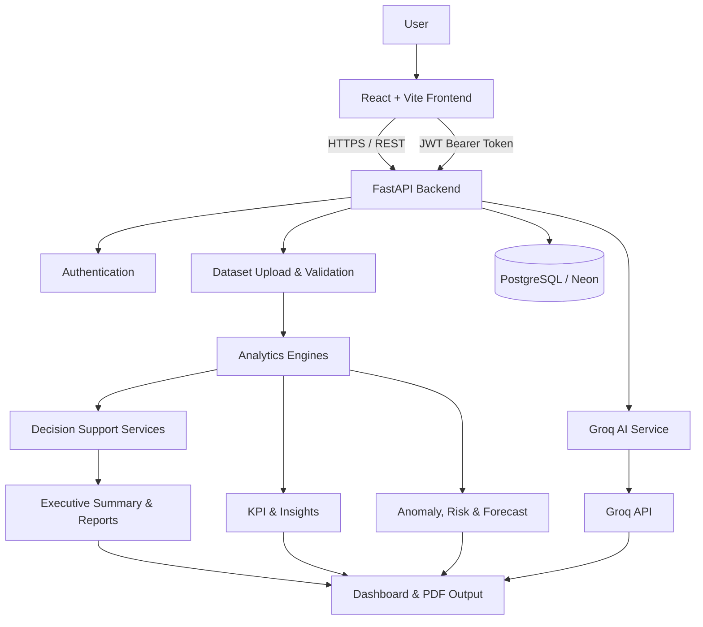

# NeuroSync

### AI-Powered Executive Decision Intelligence Platform

NeuroSync turns structured business data into decision-ready intelligence. Upload a CSV or Excel dataset, explore its analytical results through an executive dashboard, and ask questions about the selected dataset using a Groq-powered AI workspace.

<p align="center">
  <a href="https://neuro-sync-phi.vercel.app/"><strong>Live Application</strong></a>
  ·
  <a href="https://neurosync-ui16.onrender.com/docs"><strong>API Documentation</strong></a>
  ·
  <a href="https://github.com/harshvardhan-it/NeuroSync"><strong>Source Code</strong></a>
</p>

---

## Overview

Business datasets often contain useful signals that are difficult to identify quickly. NeuroSync brings data analysis, executive summaries, decision-support workflows, and conversational AI into one application.

The platform is built around a simple workflow:

1. Register or sign in.
2. Upload a CSV or XLSX dataset.
3. Let the backend validate and analyze the data.
4. Explore metrics, insights, risks, forecasts, and decision-support results in the dashboard.
5. Ask dataset-aware questions in the AI workspace.
6. Generate executive reporting outputs.

## Features

- **Executive dashboard** — a consolidated view of dataset analysis and decision-oriented information.
- **Dataset ingestion** — CSV and XLSX uploads with configurable file, row, column, and cell limits.
- **Analytical engines** — KPI calculation, insights, anomaly detection, risk analysis, and forecasting.
- **Decision support** — recommendations, executive summaries, root-cause analysis, and scenario simulation.
- **AI workspace** — conversational questions grounded in the selected dataset's derived analysis context, powered by Groq.
- **Chat history** — dataset-scoped conversation history.
- **PDF reporting** — downloadable report generation.
- **Authentication and data isolation** — JWT-based authentication and ownership checks for dataset operations.
- **API health checks** — liveness and readiness endpoints for deployment monitoring.

> The quality and relevance of generated analysis depend on the structure and contents of the uploaded dataset. NeuroSync is a decision-support tool; users should validate important business decisions against their own domain knowledge and source data.

## Live Deployment

| Component | Deployment |
|---|---|
| Frontend | [Vercel](https://neuro-sync-phi.vercel.app/) |
| Backend API | [Render](https://neurosync-ui16.onrender.com/) |
| API documentation | [FastAPI Swagger UI](https://neurosync-ui16.onrender.com/docs) |
| Database | PostgreSQL on Neon |

The backend may take a short time to respond after an idle period, depending on the hosting plan.

## Architecture



### High-level data flow

1. The frontend sends authenticated requests to the FastAPI API.
2. The backend validates uploaded CSV/XLSX files and enforces configured dataset limits.
3. The analysis pipeline computes structured analytical results.
4. Dataset metadata, analysis results, users, and chat messages are stored through the database layer.
5. The AI workspace uses the selected dataset's derived analysis context to answer user questions through Groq.
6. The frontend presents the results and supports report generation.

## Technology Stack

| Layer | Technologies |
|---|---|
| Frontend | React 19, Vite, React Router, Axios |
| UI and visualization | Tailwind CSS, Recharts, Lucide React, Anime.js |
| Backend | Python 3.11+, FastAPI, Uvicorn |
| Data processing | Pandas, NumPy, scikit-learn |
| Database and ORM | PostgreSQL, Neon, SQLModel, SQLAlchemy |
| Migrations | Alembic |
| Authentication | JWT, password hashing with bcrypt |
| AI integration | Groq API |
| Reporting | ReportLab |
| Deployment | Vercel, Render |

## Repository Structure

```text
NeuroSync/
├── backend/
│   ├── ai/                 # Analysis and AI-related modules
│   ├── config/             # Application settings
│   ├── engines/            # Analytical engines
│   ├── models/             # Database models
│   ├── routes/             # Authentication, dataset, and AI routes
│   ├── schemas/             # Request and response schemas
│   ├── services/            # Decision, summary, validation, and report services
│   ├── utils/               # Authentication, database, logging, exceptions
│   └── main.py              # FastAPI application entry point
├── frontend/
│   ├── public/
│   └── src/
│       ├── api/
│       ├── assets/
│       ├── components/
│       ├── context/
│       └── pages/
├── migrations/              # Alembic migration environment and versions
├── scripts/                 # Database migration helper
├── tests/                   # Backend tests
├── .env.example
├── alembic.ini
├── render.yaml
├── requirements.txt
└── SECURITY.md
```

## Run Locally

### Prerequisites

- Python 3.11 or later
- Node.js and npm
- Git
- A Groq API key for AI workspace functionality
- PostgreSQL for a production-like local setup (SQLite is the development default in the example configuration)

### 1. Clone the repository

```bash
git clone https://github.com/harshvardhan-it/NeuroSync.git
cd NeuroSync
```

### 2. Configure the backend

Create the backend environment file from the example:

```bash
# macOS / Linux
cp .env.example backend/.env

# Windows PowerShell
Copy-Item .env.example backend/.env
```

Edit `backend/.env` and set the required values:

- `SECRET_KEY` — use a long, random secret.
- `DATABASE_URL` — defaults to a local SQLite database in the example.
- `GROQ_API_KEY` — required for Groq-powered AI responses.
- `ALLOWED_ORIGINS` — include the frontend origin, normally `http://localhost:5173`.

Install Python dependencies and start the API:

```bash
python -m venv .venv

# Windows PowerShell
.venv\Scripts\Activate.ps1

# macOS / Linux
source .venv/bin/activate

pip install -r requirements.txt
python -m scripts.migrate
uvicorn backend.main:app --reload --host 127.0.0.1 --port 8000
```

The API will be available at:

- API root: http://127.0.0.1:8000/
- Swagger UI: http://127.0.0.1:8000/docs
- Liveness: http://127.0.0.1:8000/health/live
- Readiness: http://127.0.0.1:8000/health/ready

### 3. Configure and start the frontend

Open a second terminal:

```bash
cd frontend
npm ci
```

Create `frontend/.env` with the backend URL:

```env
VITE_API_URL=http://127.0.0.1:8000
```

Start the Vite development server:

```bash
npm run dev
```

Open http://localhost:5173.

### Useful frontend commands

Run from the `frontend/` directory:

```bash
npm run dev       # Start development server
npm run build     # Create production build
npm run preview   # Preview production build
npm run lint      # Run ESLint
```

## Environment Variables

The root `.env.example` is the starting template. The backend settings load environment variables from the process environment and from `backend/.env`.

| Variable | Purpose | Example / default |
|---|---|---|
| `APP_ENV` | Runtime environment | `development` |
| `DEBUG` | Debug setting | `false` |
| `DATABASE_URL` | Database connection | `sqlite:///./neurosync.db` |
| `SECRET_KEY` | JWT signing secret | Set a strong random value |
| `ALGORITHM` | JWT algorithm | `HS256` |
| `ACCESS_TOKEN_EXPIRE_MINUTES` | Token lifetime | `60` |
| `GROQ_API_KEY` | Groq API credential | Set your own key |
| `ALLOWED_ORIGINS` | Comma-separated allowed frontend origins | `http://localhost:5173` |
| `MAX_UPLOAD_SIZE_MB` | Maximum upload size | `10` |
| `MAX_DATASET_ROWS` | Maximum dataset rows | `250000` |
| `MAX_DATASET_COLUMNS` | Maximum dataset columns | `200` |
| `MAX_DATASET_CELLS` | Maximum total dataset cells | `5000000` |
| `AI_MAX_MESSAGE_LENGTH` | Maximum AI message length | `4000` |

The frontend uses `VITE_API_URL` to determine the backend API base URL. Only public configuration should use the `VITE_` prefix. Never put server secrets, including `GROQ_API_KEY` or `SECRET_KEY`, in frontend environment variables.

## API Overview

The API is built with FastAPI. Open the deployed [Swagger documentation](https://neurosync-ui16.onrender.com/docs) to inspect available operations and schemas.

| Area | Routes |
|---|---|
| Authentication | `/auth/register`, `/auth/login`, `/auth/me` |
| Dataset | `/dataset/*` |
| AI workspace | `/ai/chat`, `/ai/history/{dataset_id}` |
| Health | `/health`, `/health/live`, `/health/ready` |

Authenticated endpoints use a bearer access token. The frontend stores the token and attaches it to API requests.

## Deployment

### Backend — Render

The repository includes `render.yaml` for the Render web service. The configured build and start commands are:

```bash
pip install -r backend/requirements.txt
python -m scripts.migrate && uvicorn backend.main:app --host 0.0.0.0 --port $PORT
```

Configure these environment variables in Render:

- `APP_ENV=production`
- `SECRET_KEY`
- `DATABASE_URL` (PostgreSQL connection string)
- `GROQ_API_KEY`
- `ALLOWED_ORIGINS` (the exact deployed frontend origin)

The configured health-check endpoint is `/health/ready`.

### Frontend — Vercel

Deploy the `frontend/` directory as the Vercel project root and set:

```env
VITE_API_URL=https://neurosync-ui16.onrender.com
```

The frontend includes a Vercel rewrite configuration for client-side routing.

## Testing

Backend tests are located in `tests/`. With the backend virtual environment activated, run:

```bash
pytest
```

The frontend provides lint and production-build checks:

```bash
cd frontend
npm run lint
npm run build
```

## Security and Data Handling

- Use a strong production `SECRET_KEY` and PostgreSQL in production.
- Restrict `ALLOWED_ORIGINS` to trusted frontend origins.
- Keep Groq credentials on the backend; never expose them in browser code.
- Dataset endpoints enforce authenticated ownership checks.
- NeuroSync sends the selected dataset's **derived analysis context** to the configured Groq provider to support AI responses. Do not upload confidential or sensitive business data unless your organization's policies and the provider's applicable data-processing terms permit it.
- The current upload implementation stores files on local disk. Ephemeral or horizontally scaled deployments should use durable object storage.

Read [SECURITY.md](SECURITY.md) for additional security notes.

## Current Limitations

- Supported upload formats are CSV and XLSX.
- Dataset size is bounded by configurable upload, row, column, and cell limits.
- Uploaded files currently use local filesystem storage; durable object storage is a future infrastructure consideration for scaled deployments.
- AI output is generated from dataset-derived context and should be reviewed before being used for consequential decisions.
- The included test suite is a starting point, not a claim of exhaustive test coverage.

## Author

**Harshvardhan Dubey**

- GitHub: [@Harshwwe](https://github.com/Harshwwe)
- LinkedIn: [Harshvardhan Dubey](https://www.linkedin.com/in/harshvardhan-dubey-31051a294/)

---

If you find a problem or have a suggestion, feel free to open an issue in the repository.
